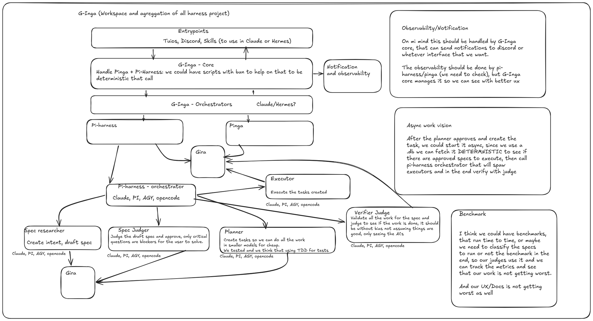
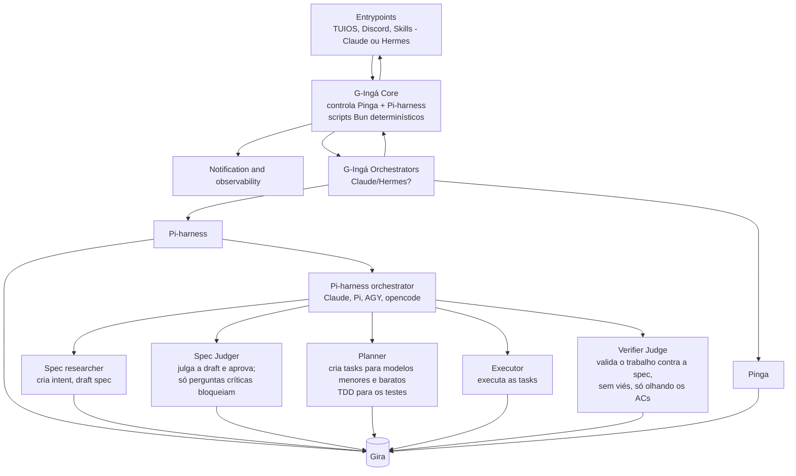

# 01 — Proposta inicial

## O desenho original, transcrito

### Notas do desenho

- **Observabilidade/notificação.** O core do G-Ingá cuida dela e pode notificar no Discord ou em qualquer outra interface. A observabilidade em si seria feita pelo pi-harness/pinga (a confirmar), com o core organizando para dar uma UX melhor.
- **Trabalho assíncrono.** Depois que o planner aprova e cria a task, ela pode rodar de forma assíncrona. Como o estado fica num `.db`, dá para consultar de forma **determinística** se existem specs aprovadas para executar e, nesse caso, chamar o orquestrador do pi-harness, que sobe os executores e no fim verifica com o judge.
- **Benchmark.** Benchmarks rodando de tempos em tempos, ou specs classificadas para rodar o benchmark no fim. Os judges usam o resultado e as métricas ficam registradas, para garantir que o trabalho, a UX e as docs não pioram.

## Primeira revisão

### Pontos fortes

- Os juízes são separados dos autores (Spec Judge e Verifier Judge).
- O trabalho assíncrono é disparado pelo `.db`, de forma determinística e auditável.
- O Planner com TDD bate com o `pinga prove-red`.
- O Gira funciona como serviço de contexto compartilhado.

### Problemas apontados

1. **Duas camadas de orquestração** (G-Ingá Orchestrators e Pi-harness orchestrator). O core deveria ser uma máquina de estados determinística; o LLM só roda dentro dos papéis.
2. **O papel do Pinga não está claro.** Ele é o *gate* entre o Executor e o Judge: o receipt `ok` vem antes do julgamento do LLM.
3. **Não há uma fonte única de estado.** Ledger do pinga e estado do pi-harness precisam de um único dono para o ciclo de vida.
4. **Falta o caminho de falha** (retries, quarentena, escalada).
5. **O judge precisa ser realmente cego**: sem transcript do executor, de preferência com outro modelo ou fornecedor, e com os testes do Planner fora do `touch`.
6. **Observabilidade:** cada ferramenta emite os próprios eventos e o core apenas roteia.
7. **O benchmark vira AC**, ligado à classificação da spec.
8. **O Gira aparece duas vezes.** No desenho é intencional, para facilitar as ligações; na prática é um CLI ou MCP.

Como cada ponto foi resolvido está em [02 — Visão atualizada](02-visao-atualizada.md).
