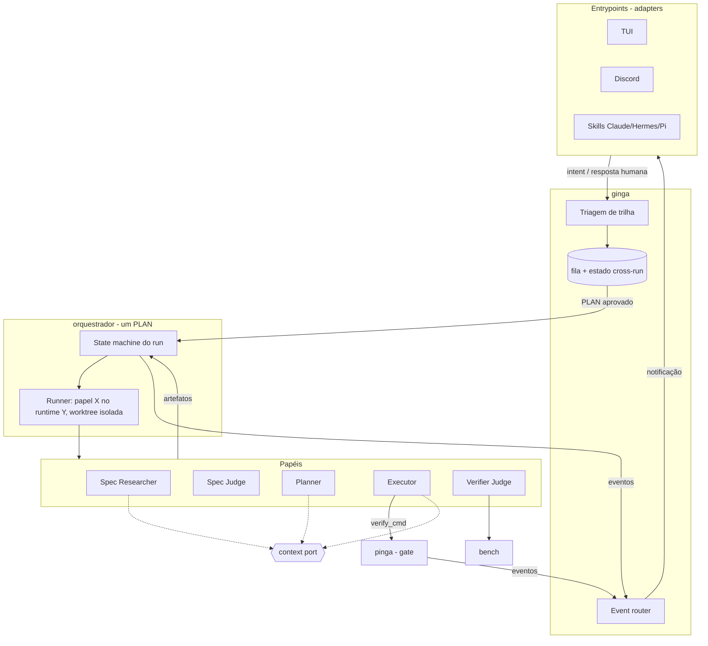
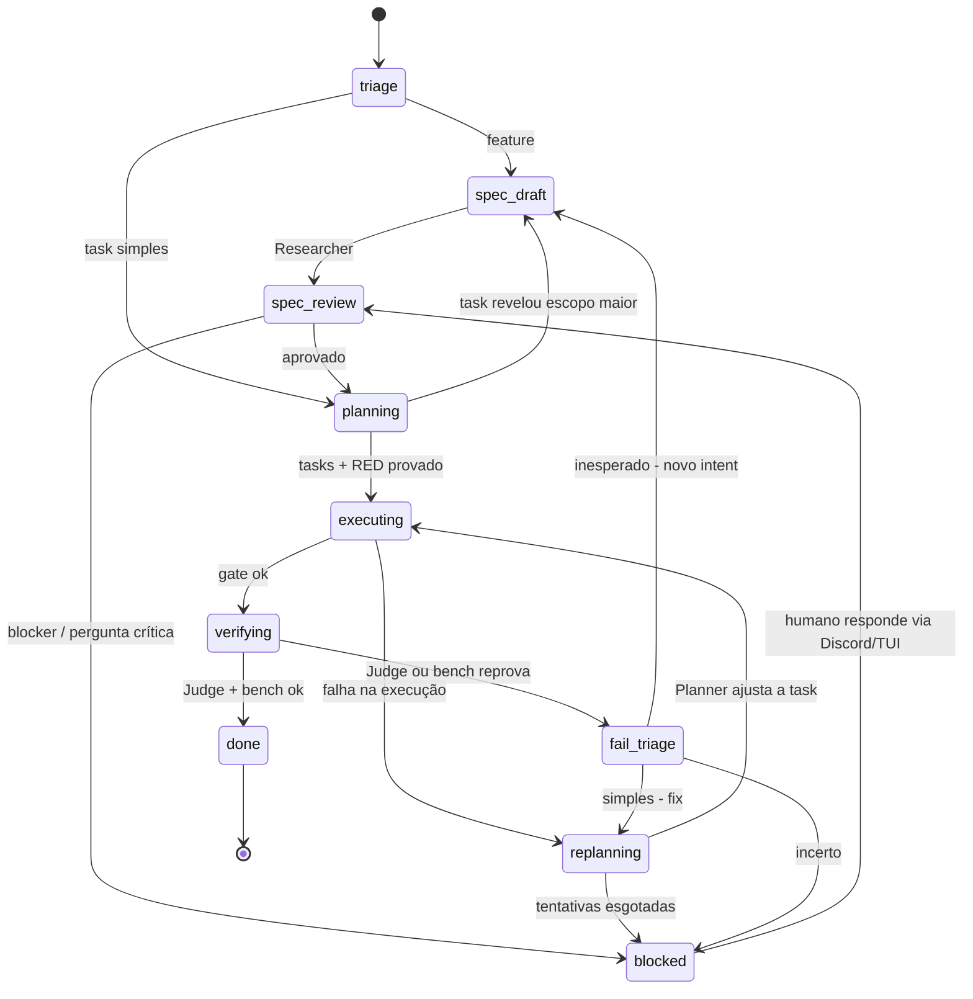

# 02 — Visão atualizada

Objetivo: montar **um harness pessoal** que funcione em qualquer projeto e com as ferramentas que a pessoa quiser. Hoje ele é dogfooding neste workspace. Cada peça também precisa ser usável sozinha: dá para usar só o pinga, ou só o orquestrador.

## 1. Pacotes e dependências

> **Decisão (2026-10-27):** o pi-harness sai como pacote. O motivo é que o orquestrador dele roda como extensão do Pi. O núcleo é extraído para um **orquestrador agnóstico**, o **Manda-CARU** (`manda`, ver [DECISION-0001](../../decisions/DECISION-0001-nomes.md)); Pi, Claude, Hermes, OpenCode, Codex e AGY viram adapters. O pinga é enxugado até ser só o gate, e o que sobrar dele vai para o ginga. Ver [03 §7](03-situacao-atual.md#7-discussão-o-futuro-do-pi-harness).

```mermaid
flowchart TB
  GINGA[g-inga (CLI: ginga)<br/>cola + UX + async]  %% (2026-10-28) repo/pacote g-inga, CLI ginga
  OR[orquestrador<br/>pipeline de papéis]
  PG[pinga<br/>contrato + verificação + ledger]
  RT{{runtime port}}
  HO{{host port}}
  CTX{{context port}}
  SB{{sandbox port}}  %% (2026-10-28) INTENT-0006
  OBS{{observabilidade<br/>OTLP + OpenInference}}  %% (2026-10-28) DECISION-0003
  PI[pi]
  CL[claude / codex / opencode / agy]
  GR[gira]
  GF[graphify]
  RG[rg + git<br/>fallback embutido]

  GINGA --> OR
  GINGA --> PG
  OR --> RT
  HO --> OR
  OR --> SB
  GINGA --> OBS
  RT --> PI
  RT --> CL
  OR -.-> CTX
  PG -.-> CTX
  CTX --> GR
  CTX --> GF
  CTX --> RG
```

Linhas tracejadas são dependências **opcionais**. O grafo não tem ciclos, e cada nível funciona sem os de cima. **Host** é de onde o orquestrador é acionado (CLI, skill no Claude, extensão no Pi, plugin no Hermes). **Runtime** é quem executa os papéis.

| Pacote | Dono de | Usado sozinho serve para |
|---|---|---|
| **gira** | Contexto, impacto, docs vivas | Contexto barato para qualquer agente |
| **pinga** | Verificação de TASK e PLAN, prove-red, ledger, judge (família distinta), fila só leitura | Disciplina de contrato em qualquer workflow, até manual |
| **orquestrador** | Pipeline de papéis dentro de um PLAN: spawn por runtime, retries, replan, judge cego, gate plugável, worktrees | INTENT → SPEC → PLAN → TASKs → judge com os runtimes que a pessoa tiver |
| **ginga** | Entrypoints (TUI, Discord, web, HUD), triagem de trilha, fila assíncrona, eventos e notificações, install/adopt, memória (learn/DREAMS), benchmark | O harness completo |

Os artefatos (INTENT, SPEC, PLAN, TASK) e a convenção de arquivos estão em [04 — Artefatos](04-artefatos.md).

### Regras de integração

- **Só CLI, JSON e arquivos.** Nenhum pacote importa o código interno de outro.
- **Saídas JSON versionadas** (`--json` com `schema_version`).
- **Semver com ranges.** O ginga declara as versões compatíveis e o `ginga doctor` verifica.
- **O orquestrador não conhece o pinga.** Ele expõe um gate genérico (`verify_cmd`/hook). Sozinho, o gate pode ser `npm test`; com o ginga, o gate é o `pinga verify`.
- **Eventos sem dependência.** Cada ferramenta escreve JSONL em `$GINGA_EVENTS` quando a variável existe. O formato é uma spec em documento, não uma lib compartilhada.
- **CLI primeiro, MCP como wrapper fino e opcional.**

## 2. Portas e adapters

Todo ponto externo é uma porta com adapters, e cada porta tem um fallback que funciona sem nada extra.

| Porta | Adapters | Fallback |
|---|---|---|
| Contexto | gira, graphify, comando custom | rg + git |
| Runtime | Pi, Claude, Codex, AGY, opencode | Pi (único requisito) |
| Notificação | Hermes (Discord, Telegram, Slack…), webhook direto do Discord, push do tuios | log/stdout |
| Verificação (gate) | pinga | comando de teste do projeto |
| Sandbox | bwrap, none | nenhum (execução nua proibida) | (2026-10-28) |
| Observabilidade | OTLP + OpenInference (backend padrão: `ginga serve /v1/traces` + Roda) | Phoenix, Jaeger, Grafana Tempo etc. via `GINGA_OTLP_ENDPOINT` | (2026-10-28) |
| Benchmark | a definir | nenhum (sem métricas) |

### Context provider

O protocolo segue o estilo dos *credential helpers* do git: um executável que recebe uma capacidade e devolve JSON.

```
<provider> capabilities --json   → ["outline","slice","impact"]
<provider> outline <path> --json
<provider> slice   <symbol> --json
<provider> impact  <path|symbol> --json
```

- A interface sai do que o pinga e o orquestrador **realmente consomem** (hoje: pinga e pi-harness), não do que o gira sabe fazer.
- Capacidades ausentes degradam o comportamento sem quebrar. Sem `impact`, por exemplo, a triagem fica mais conservadora.
- Extras ficam em namespace próprio (`gira:tour`, `gira:docs`) e são usados quando disponíveis. O padrão não vira teto.
- O Verifier Judge **não** usa o context provider.

### Contrato por projeto

Este é o único ponto que conhece o projeto (esboço):

```toml
# .ginga/project.toml
[commands]
test  = "mvn test-compile surefire:test"
build = "mvn -q package"
bench = "./bench/run.sh"        # opcional

[context]
provider = "gira"               # graphify | rg | <comando>

[runtimes]                       # sobrescreve o models/ROUTING.md só neste projeto
planner  = "claude"
executor = "pi:cheap-model"
judge    = "opencode:other-vendor"
```

Precedência: `project.toml [runtimes]` > `models/ROUTING.md` > padrões embutidos. Um papel fixado no projeto ignora a escada de tiers do ROUTING.

### Roteamento de modelos (2026-10-28)

Vigente (substitui a tabela antiga onde conflitar): Go só dentro do `opencode run` (assinatura); fora dele, proibido. Modelos free do Zen só funcionam no opencode. Pi só usa Zen pago barato. **Nunca** escalar automaticamente para modelo forte: o pro só entra com `tier: strong` explícito. Teto por rodada somando tudo, em `paid-spend.tsv`; Go dentro do opencode não conta.

| Papel | Onde roda | Modelo (em ordem) |
|---|---|---|
| Executor | `opencode run --standalone` | `opencode/glm-5.3-flash-free` → `opencode/deepseek-v4.1-flash-free` → `opencode-go/qwen3.8-flash` → `opencode-go/deepseek-v4.1-flash`; com `tier: strong`: `opencode-go/deepseek-v4-pro` |
| Operador | script / `manda run` | `opencode run` com `opencode-go/deepseek-v4.1-flash` |
| Planner (RED) e pesquisa | Claude Code pela assinatura, sessão curta | `claude-opus-5-5`; se a quota acabar: `opencode run` com `opencode-go/deepseek-v4-pro` |
| Judge | outra família | Codex `gpt-6-luna` + Gemini `gemini-3.8-flash` (agy) |
| Pi (quando usado) | Pi | `opencode/qwen3.8-flash` ou `opencode/deepseek-v4.1-flash` (Zen pago) |

Detalhe e tetos por modelo: [models/ROUTING.md](../../../models/ROUTING.md).

### Skills e hooks (INTENT-0009, 2026-10-28)

Fonte única em `.ginga/skills/<nome>/{SKILL.md, scripts/*.ts, references/, assets/}` + `hooks.toml` + perfis de sandbox em `project.toml`. O `ginga install`/`init` projeta para cada runtime (Claude, Codex, OpenCode, Pi, AGY, Hermes). Hooks de enforcement ficam **fora** da sandbox (host), onde o modelo não contorna; hooks dentro da sandbox são conveniência. MVP: 3 skills (`pinga`, `red-audit`, `gira-context`) + 3 hooks do host (`bashRefusal`, teto de custo pré-chamada, `tests_frozen` ro-bind). Detalhe: [research/skills-e-hooks.md](../../research/skills-e-hooks.md) e [SPEC-0002](../../../specs/SPEC-0002-skills-e-hooks.md).

### Desbloqueio automático (INTENT-0008, 2026-10-28)

Na rota de falhas, o executor escreve `BLOCKED: <motivo>` classificado (`contract_conflict`, `missing_dep`, `id_collision`, `gate_false_positive`, `env_dependency`, `other`). Para classes conhecidas, o harness gera uma TASK de desbloqueio com `depends_on` invertido e roda de novo. Limites: no máximo 1 desbloqueio automático por TASK e 2 por PLAN; `other` e mudança de abordagem vão para o humano. Prevenção no Planner: rodar `done_when` contra o contrato e checar unicidade do `pinga_task` antes de despachar.

### Sandbox (INTENT-0006, 2026-10-28)

Porta `Sandbox` separada da porta de runtime: `sandbox.run(profile, cmd, worktree) → {exit, outbox}`. Perfil declarativo por runtime e por papel (`mounts`, `env`, `net`, `needs:`). Fase 1 feita: `sandbox-done-when.sh` com bwrap, `--unshare-net`, HOME falso, `.git` somente leitura e identidade git por variável. Detalhe: [10-sandbox.md](10-sandbox.md).

### Donos

| Coisa | Dono |
|---|---|
| Claim/lease de TASK | `ginga tick` (com o `state.db`); o manda recebe a TASK já reivindicada |
| Judge | **roda** no manda (escolhe o runtime de outra família) e o veredito é **selado** pelo pinga (`pinga judge` → receipt) |
| Escrita no `.ginga/` | **Contrato** (INTENT/SPEC/PLAN/TASK/LEARNINGS): agentes e humanos, via arquivo. **Estado de execução**: só `ginga serve`/`tick`, no `state.db` |
| "Feito" | receipts `pass` no ledger do pinga + o Verifier Judge; o ginga deriva o status do PLAN a partir deles |

## 3. Arquitetura em camadas



Princípio: **os papéis só se comunicam por artefatos em arquivo e pelo estado.** Isso mantém o judge cego, deixa o runtime trocável e permite retomar de qualquer ponto.

## 4. Trilhas e ciclo de vida

- **Feature:** INTENT → SPEC → PLAN → TASKs → verificação. O async começa no PLAN aprovado.
- **Pequena:** INTENT → PLAN (sem SPEC, em geral com 1 TASK) → verificação. Não há caminho especial: é só um PLAN sem SPEC.
- A triagem usa primeiro critérios determinísticos (blast radius pelo contexto, número de arquivos, contrato novo, flag do usuário) e um LLM barato só para desempatar. Começa conservadora (na dúvida, feature) e afrouxa com dados.



### Rotas de falha

| Falha | Rota |
|---|---|
| Execução | O Planner analisa e ajusta a task, que volta ao Executor (máximo de N tentativas) |
| Spec com blocker | Notificação no Discord (hoje). O humano abre uma conversa pelo Discord ou outra interface para desbloquear |
| Judge ou bench | O Planner classifica: algo simples vira task de *fix*; algo inesperado ou complexo vira novo intent e volta ao Researcher |
| Tentativas esgotadas | `blocked` + notificação |
| Desbloqueio automático (2026-10-28) | TASK de desbloqueio gerada por classe de `BLOCKED:` (INTENT-0008), limitada a 1 por TASK e 2 por PLAN; `other` vai para o humano |

## 5. Responsabilidades dos papéis

| Papel | Faz | Entrada → Saída | **Não faz** |
|---|---|---|---|
| **Spec Researcher** | Transforma intent em spec com ACs verificáveis | INTENT + contexto → `SPEC-*.md` | Não escreve código nem tasks |
| **Spec Judge** | Aprova a spec ou levanta só blockers críticos | `SPEC-*.md` → `VERDICT.json` | Não reescreve a spec |
| **Planner** | Escreve o PLAN e o divide em TASKs de 25 linhas, escreve os testes RED, analisa falhas (fix ou novo INTENT) | INTENT/SPEC/falha → `PLAN.md` + `TASK-*.md` + testes | Não implementa |
| **Executor** | Implementa até ficar GREEN dentro do `touch` | `TASK-*.md` → diff + receipt | Não mexe nos testes do Planner nem fora do `touch` |
| **Verifier Judge** | Julga os ACs só com artefatos crus | SPEC/PLAN + diff + receipts + métricas → `VERDICT.json` | Não lê código do repo, transcript nem raciocínio do executor |

| Componente | Faz | **Não faz** |
|---|---|---|
| **Entrypoints** | Recebem intent, mostram estado, coletam respostas | Não decidem nada, não chamam papéis |
| **Triagem (ginga)** | Escolhe a trilha e promove task para feature | Não rebaixa feature para task |
| **State machine (orquestrador)** | Transições, retries e orçamento de um run | Não usa LLM para decidir transição |
| **Runner (orquestrador)** | Sobe o papel no runtime, em worktree isolada | Não interpreta o conteúdo |
| **Event router (ginga)** | Roteia eventos para os notifiers | Não faz polling ad hoc das ferramentas |
| **pinga** | Contrato, RED, verify, ledger imutável | Não orquestra |
| **bench** | Mede e compara com o baseline | Não aprova; quem decide é o Judge |

## 6. Em aberto

- **Benchmark.** Por enquanto, a spec ganha uma tag `bench: perf | docs | ux | none` e o Judge aceita `metrics.json`, para que a interface exista antes da implementação. "Docs/UX não piorou" precisa de proxies mensuráveis (cobertura de docs, links quebrados, snapshot de TUI).
- **Critérios numéricos da triagem.**
- ~~Onde o ginga roda~~: resolvido em [DECISION-0002](../../decisions/DECISION-0002-mensageria-e-fila.md).
- **Isolamento e orçamento:** worktree por executor e limite de custo e tempo por task.
