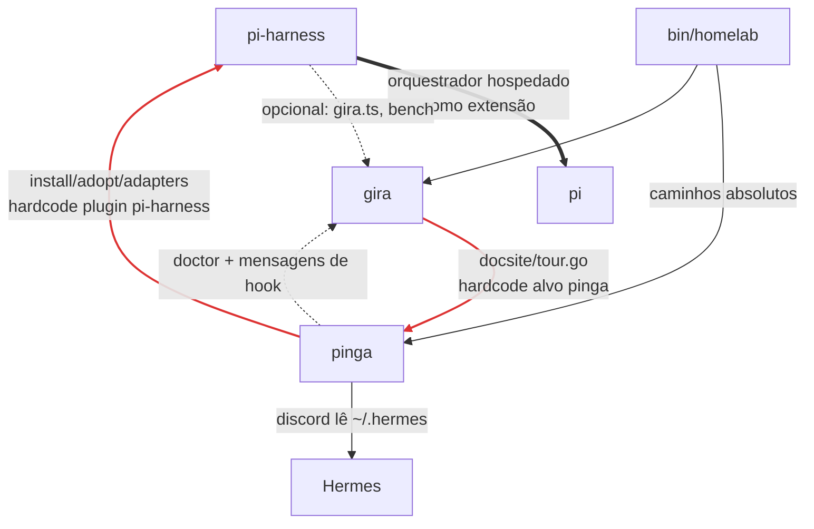
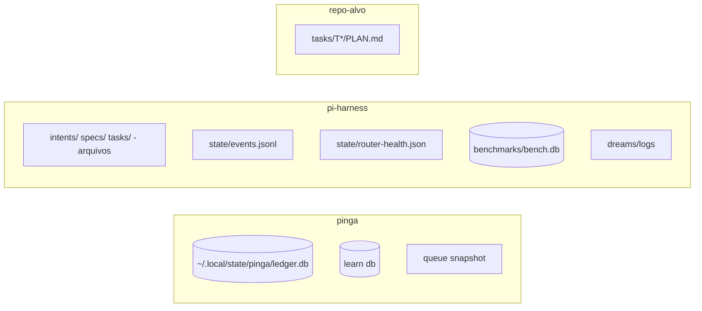

# 03 — Situação atual

> Levantamento de 2026-10-27, feito sobre os repos principais e todas as worktrees. Os números de linhas são aproximados (`wc -l`).

## 1. Inventário

| Repo / worktree | Branch | Estado |
|---|---|---|
| `p-inga` | `main` | Principal. Último commit: T61 (protocolo de fila no AGENTS.md) |
| ~~`p-inga-enq`~~ | — | Removida em 2026-10-27 |
| ~~`p-inga-exec`~~ | — | Removida em 2026-10-27 (mudanças idênticas à main) |
| `p-inga-governed-roles` | `task/governed-model-roles` | T35: correlação de receipt no `web/server.ts` (não commitado, base antiga) |
| `p-inga-run-status` | `task/hermes-run-status` | Só o plano: status read-only de um run para o Hermes |
| ~~`p-inga-ux`~~ | — | Removida em 2026-10-27 |
| `pi-harness` | `main` | Principal. Intents 0054 e 0055 não rastreadas (0055 = console unificado + renomear homelab → G-Ingá) |
| `pi-harness-ux` | `task/ux-unificado` | ~780 linhas não commitadas (HUD, TUI driver, claude-plugin) |
| `pi-harness-bench-uxjudge` | `task/bench-uxjudge-import` | T37: importador de bench sem falso 100% (não commitado) |
| `gira-g` | `main` | Principal. Último: outline de símbolos Go |
| `gira-g-ux` | `task/ux-unificado` | ~430 linhas não commitadas (docsite) |

Na raiz do workspace também existem `bin/homelab` (CLI unificada em bash), `docs-benchmark/`, `llm-bench/` e vários `PROMPT-ORQUESTRADOR-*.md`.

## 2. O que cada pacote faz hoje

### pinga (~14k linhas, Bun/TS)

O núcleo é o que a visão prevê: `plan`, `prove`, `verify`, `receipt`, `ledger`, `guards`, `breaker`, `supersede`. Mas ele já cresceu para fora disso:

| Módulo | O que faz | Na visão, pertence a |
|---|---|---|
| `judge.ts` | Judge com família de modelo distinta (`assertDistinctFamily`) | **pinga** (é verificação) |
| `queue.ts` | Fila derivada do ledger + claim/lease + snapshot + digest | leitura → pinga; claim/lease → orquestrador |
| `maestro.ts` | Envelopes `task.request`/`maestro.receipt`, scoreboard de workers (FTPR, tokens) | orquestrador / ginga |
| `discord.ts` | Notifica receipts e digests; lê config de `~/.hermes/profiles/pinga/.env` | ginga (notifier) |
| `learn.ts`, `lessons.ts`, `transcript.ts` | Ingestão de sessões multi-harness, lições | ginga (observabilidade/memória) |
| `install.ts`, `adopt.ts`, `adapters/*` | Instala plugins em Claude/Hermes/OpenCode/Pi/TUIOS, **com o nome `pi-harness` hardcoded** | ginga (instalação) |
| `web/` | Painel web :4242, SSE | ginga (entrypoint) |
| `eval.ts`, `docs_eval.ts` | Avaliações | bench |

### pi-harness (~12.5k linhas em `src/` + ~20k em `.pi/extensions/`)

- **O orquestrador mora dentro do Pi.** `.pi/extensions/sdlc.ts` (~4.7k linhas) registra `/intent`, `/spec`, `/pipeline`, `/task` e `/reality` como comandos do Pi. São 14 arquivos de extensão usando a API do Pi. Hoje o pipeline só é acionado de dentro do Pi.
- **Os runners já são agnósticos** (mas moram em `.pi/extensions/runners.ts`, não em `src/`; o Codex como worker fica atrás do gate `PI_CODEX_ENABLED`, `runners.ts:89`). `runners.ts` sobe `pi`, `claude`, `opencode`, `codex` e `agy` em modo headless, e `router.ts` mantém pools por papel (planner/decomposer/worker/judge) e por tier (free/medium/strong). **Escolher o runtime já é algo resolvido**; o problema está em quem hospeda o orquestrador.
- **Já existem plugins para outros hosts:** `claude-plugin/` (HUD e as tools MCP `harness_next`/`harness_status`), `hermes-plugin/` e a projeção de skills (`src/hosts`).
- Além disso há `src/async` (dispatcher, budget scheduler, checkpoint/resume), `src/autonomy` (tiers gated → full), `src/intent` (spec_judge, tier_judge, linters), `src/pipeline` (task_runner, worktree, judge_guard) e `src/bench`.
- `src/bench` tem uma ontologia SQLite (`experiment → arm → run → event`, `methodology_version`). É o **benchmark mais maduro** do workspace.
- `state/events.jsonl` já registra eventos `attempt` com runner, modelo, tier, tokens, custo e motivo de falha. É uma boa semente para o formato de eventos.

### gira (Go)

Folha do grafo: outline, read, write, impact, slice, docsite e MCP. `bench/` é um benchmark comparativo isolado (gira contra Graphify e outros), separado do resto.

## 3. Dependências reais

Comparado com a visão (`ginga → {orquestrador, pinga}`, `orquestrador → contexto`, `pinga → contexto`):

| # | Acoplamento | Gravidade | Correção |
|---|---|---|---|
| A1 | O orquestrador do pi-harness é uma extensão do Pi | **alta** | Extrair o núcleo para uma lib/CLI; o Pi vira um host adapter, igual aos plugins de Claude e Hermes |
| A2 | pinga → pi-harness (`install`/`adopt`/`adapters` com o plugin `pi-harness` hardcoded) | **alta**, dependência invertida | Mover a instalação de plugins para o ginga |
| A3 | gira → pinga (`docsite/tour.go` com caso especial para pinga) | média, a folha conhece a camada de cima | Tour configurável por projeto |
| A4 | Discord do pinga lê config do Hermes | média | Notifier vira porta no ginga |
| A5 | `bin/homelab` com caminhos absolutos (`DUH_ROOT`, caminho do bun) | média, não é portável | Vira o `ginga` CLI |
| A6 | pinga → gira | baixa, já é suave | Mensagens de hook condicionais ao provider |

## 4. Duplicações

| Conceito | No pinga | No pi-harness |
|---|---|---|
| Task / contrato | `tasks/T<N>/PLAN.md` (`touch`, `done_when`) | `tasks/NNNN/task-*.md` (1 target file, ACs booleanos) |
| Judge | `judge.ts` (família distinta) | `intent/spec_judge.ts`, `pipeline/judge_guard.ts`, `ux-judge.ts` |
| Fila / async | `queue.ts` (claim/lease) | `src/async` (dispatcher, scheduler) |
| Scoreboard de modelos | `maestro.ts` (FTPR por worker) | `router/health_ledger.ts`, `bench/rate_card.ts` |
| Memória / lições | `learn.ts`, `lessons.ts` | `dreams.ts` → `LESSONS.md` |
| Observabilidade | `web/` + SSE | `hud/`, `claude-plugin/hooks/hud*` |
| Notificação | `discord.ts` | (via Hermes) |
| Verificação | `verify` + ledger | `verifier.ts` (Reality BDD) + `contract_verifier.ts` |
| Benchmark | `eval.ts`, `docs_eval.ts` | `src/bench` (SQLite) + `benchmarks/`; fora dos dois: `llm-bench/`, `docs-benchmark/`, `gira-g/bench/` |

## 5. Onde o estado vive

Não existe hoje um dono único para o ciclo de vida da tarefa: o estado está dividido entre o ledger do pinga e os arquivos do pi-harness.

> Revisão independente (2026-10-27): A2–A6 e os tamanhos foram confirmados. Não estão rastreados no git e correm risco de perda: `pi-harness/HANDOFF-0043.md`, `intents/0054` e `0055`.

## 6. Gap em relação à visão (rascunho)

1. **Extrair o orquestrador do Pi (A1).** É o maior gap, e também a decisão sobre o futuro do pi-harness (ver discussão abaixo).
2. **Enxugar o pinga** até contrato + verify + ledger + judge + fila em modo leitura. Install, Discord, web, learn e maestro saem (A2, A4).
3. **Unificar o formato de task** (PLAN.md do pinga como contrato único?).
4. **Unificar os eventos** a partir do `events.jsonl` + receipts, no formato `$GINGA_EVENTS`.
5. **Consolidar o bench** a partir de `pi-harness/src/bench`.
6. **Remover os hardcodes** (A3, A5).
7. **Limpar as worktrees** (decidir o destino de cada uma).

## 7. Discussão: o futuro do pi-harness

A proposta é tirar o pi-harness e ficar só com o pinga, criando outro pacote com outro nome se fizer sentido dividir. **Recomendação: dividir.** Concordo em tirar o acoplamento com o Pi, mas não em jogar a orquestração dentro do pinga.

- O acoplamento ao Pi não está nos runners (eles já sobem cinco runtimes). Está em **onde o orquestrador roda**: comandos `/pipeline` registrados como extensão do Pi.
- Se a orquestração for para o pinga, ele deixa de ser usável sozinho como disciplina de contrato. E o pinga já está inchado (install, Discord, web, maestro).
- Proposta:
  - **pinga** fica com contrato, verify, ledger, judge e fila em leitura. É o gate.
  - **Manda-CARU** (`manda`) é o orquestrador agnóstico, extraído de `sdlc.ts`, `runners`, `router`, `worktree`, `async`, `autonomy` e `intent`. Expõe uma CLI e uma lib. Pi, Claude, Hermes, OpenCode, Codex e AGY entram como **host adapters** (de onde é acionado) e **runtime adapters** (quem executa os papéis).
  - **ginga** concentra install/adopt, Discord, web, HUD, learn/DREAMS, bench e `bin/homelab`.
