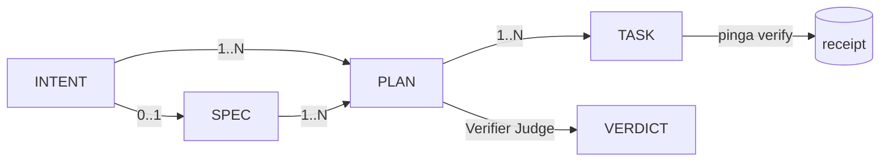

# 04 — Artefatos e convenção de arquivos

## 1. Os quatro artefatos

| Artefato | Quem escreve | Responde | Verificado por |
|---|---|---|---|
| **INTENT** | Humano, via entrypoint | *O que foi pedido*: o pedido cru, como chegou | É a referência do que o humano pediu de fato |
| **SPEC** | Researcher | *O quê e por quê*: objetivo e ACs em linguagem de negócio | Spec Judge (antes) e Verifier Judge (no fim) |
| **PLAN** | Planner | *Como*: abordagem, ordem e dependências das TASKs, `done_when` de integração | Linter determinístico + gate de integração (pinga) |
| **TASK** | Planner | *Uma operação*: `touch`, `done_when`, `tests_frozen`, tier. Feita para modelos baratos | pinga |

**Dentro do PLAN, além das TASKs:** `log.md` (o que aconteceu, escrito pelo sistema) e `LEARNINGS.md` (o que sabemos agora, escrito pela sessão a cada check). Ver [06 — Handoff e learnings](06-handoff-e-learnings.md).

**Tipos de PLAN:** `kind: change` (padrão) ou `kind: investigation` (debug e pesquisa: cada TASK é uma hipótese, e o resultado vira learning).

**Gerados, nunca escritos à mão:** `VERDICT.json` (judges), `metrics.json` (bench) e os receipts (no ledger, não em arquivo).

## 2. Cardinalidade



- Toda cadeia começa num **INTENT**.
- Toda **SPEC** tem ao menos 1 PLAN. Nem todo **PLAN** tem SPEC: um PLAN sem SPEC é a trilha pequena.
- Todo **PLAN** tem ao menos 1 TASK, e toda **TASK** pertence a exatamente 1 PLAN.
- Uma tarefa pequena é um PLAN com 1 TASK. Não existe caminho especial.

## 3. Onde começa o async

**No PLAN aprovado.**

- Tudo antes dele (INTENT → SPEC, blockers, perguntas) precisa de humano ou de julgamento. É síncrono por natureza.
- Tudo depois dele (TASKs → verify → judge → replan) é mecânico. É onde o async e os modelos baratos rendem.
- A regra do dispatcher é determinística: `PLAN.status = approved` e existem TASKs abertas cujas dependências (`depends_on`) já fecharam, então despacha.

### Como o PLAN é aprovado

- **Com SPEC:** a SPEC já foi aprovada pelo Spec Judge ou pelo humano. O PLAN passa pelo linter.
- **Sem SPEC:** só o linter determinístico, sem juiz LLM. Ele checa que:
  - toda TASK tem `touch`, `done_when` e `tests_frozen`;
  - o grafo de `depends_on` não tem ciclo;
  - TASKs que podem rodar em paralelo não tocam os mesmos arquivos;
  - toda TASK aponta para o PLAN da sua pasta.

Ponto de partida: `pi-harness/src/intent/decomposition_linter.ts`.

## 4. Rotas de falha por artefato

| Falha | Ação |
|---|---|
| TASK falha no verify | O Planner reescreve **a TASK**; o PLAN continua o mesmo |
| TASK revela uma abordagem errada | O Planner reescreve **o PLAN** (replan) |
| O Judge reprova algo simples | O Planner adiciona uma **TASK de fix** ao PLAN |
| O Judge reprova algo inesperado | Novo **INTENT/SPEC**; o PLAN atual fica `superseded` |
| Tentativas esgotadas, ou blocker na SPEC | `blocked` + notificação; o humano desbloqueia pelo entrypoint |

## 5. Convenção de arquivos

### Princípio: o arquivo guarda o contrato, o db guarda a execução

| Onde | O quê | Por quê |
|---|---|---|
| Frontmatter | Contrato e **aprovação** (`draft`, `approved`, `superseded`) | É decisão humana, versionada em git (fora de git, como no duh-homelab, o registro é o `log.md` + evento `transition`) |
| db / ledger | Execução: `executing`, tentativas, `failed`, receipts, custo | Muda o tempo todo. No arquivo, cada tentativa viraria um commit e os executores paralelos entrariam em conflito |

### OKF como compatibilidade, não como fundação

Os arquivos são **OKF v0.1 válidos**: `type` em tudo, `log.md` onde fizer sentido, links markdown para navegar. Mas:

- **não dependemos de ferramentas do OKF**; parser e validador são nossos;
- **as relações estruturais ficam em campos do frontmatter** (`intent`, `spec`, `plan`, `depends_on`) e no aninhamento de pastas, nunca só em links na prosa, porque links OKF não têm tipo;
- o `index.md` raiz declara `okf: "0.1"`.

Se o OKF mudar ou morrer, não perdemos nada. Se pegar, ganhamos visualizador e interoperabilidade.

### Layout

```
.ginga/                                    # bundle OKF
  index.md                                 # okf: "0.1", visão geral (gerado)
  log.md
  intents/INTENT-0031-pipeline-resiliente.md
  specs/SPEC-0031-pipeline-resiliente.md
  plans/PLAN-0031-pipeline-resiliente/
    PLAN.md                                # type: plan
    TASK-01-runner.md
    TASK-02-docs.md
    log.md                                 # o que aconteceu (sistema)
    LEARNINGS.md                           # o que sabemos (sessão)
    VERDICT.json                           # gerado
  knowledge/
    lessons/                               # LESSON-*.md, type: lesson (promovidas dos LEARNINGS)
    decisions/                             # type: decision (ADRs)
  handoffs/                                # HANDOFF-<data>-<PLAN>.md, type: handoff (gerado)
```

- **IDs:** INTENT, SPEC e PLAN têm numeração **sequencial própria** (o primeiro artefato de uma cadeia pode reaproveitar o número do INTENT, mas não é obrigatório). A ligação fica no frontmatter (`intent:`, `spec:`), não no número. TASKs são numeradas dentro do PLAN. *(Revisado em 2026-10-27: a regra antiga, número herdado com sufixo `.N`, não escalava para uma SPEC com 12 PLANs.)*
- **`mode`:** `mvp | padrao | completo` (os valores aceitos pelo pinga, `p-inga/src/plan.ts`).
- **`repo`:** em TASKs de repos irmãos, diz o repo-alvo. `touch` e `done_when` são relativos à raiz dele. Os PLANs ficam no `.ginga/` do workspace, que é o quadro único.
- **`PLAN.md` e não `index.md`:** é explícito no editor e no glob (`plans/*/PLAN.md`). No OKF, `index.md` é a visão geral do diretório; se existir dentro da pasta do PLAN, é gerado.

### Frontmatter

```yaml
# intents/INTENT-0031-pipeline-resiliente.md
---
type: intent
title: Pipeline não pode parar na primeira task que falha
source: discord              # tui | discord | skill | cli
timestamp: 2026-10-27T14:00:00Z
---
<pedido cru>
```

```yaml
# specs/SPEC-0031-pipeline-resiliente.md
---
type: spec
title: Pipeline resiliente
intent: INTENT-0031-pipeline-resiliente
status: approved             # draft | blocked | approved | superseded
bench: none                  # perf | docs | ux | none
---
## Objetivo
## ACs
```

```yaml
# plans/PLAN-0031-pipeline-resiliente/PLAN.md
---
type: plan
title: Pipeline resiliente
intent: INTENT-0031-pipeline-resiliente
spec: SPEC-0031-pipeline-resiliente     # opcional: ausente = trilha pequena
status: approved                        # draft | approved | superseded
done_when: "bun test"                   # gate de integração
---
## Abordagem
## Ordem / dependências
```

```yaml
# plans/PLAN-0031-pipeline-resiliente/TASK-01-runner.md
---
type: task
goal: "Runner continua após falha de task"       # obrigatório (pinga)
title: Runner continua após falha de task         # opcional
plan: PLAN-0031-pipeline-resiliente
depends_on: []
tier: free
mode: padrao
touch: [src/pipeline/task_runner.ts]
done_when: "bun test tests/unit/task_runner.test.ts"
tests_frozen: [tests/unit/task_runner.test.ts]   # escrito pelo Planner (RED), o Executor não toca
---
```

## 6. Consequências para o que existe

- **pinga:** o `tasks/T<N>/PLAN.md` atual **é uma TASK** com outro nome. O pinga passa a verificar `TASK-*.md`, com o schema dele (`mode`, `goal`, `done_when`, `touch`, `tests_frozen` obrigatórios; `type`, `plan`, `depends_on`, `tier`, `title` opcionais para ele) e ganha a verificação de PLAN (`done_when` de integração depois que todas as TASKs passam). Ele continua sendo o único emissor de receipts.
- **pi-harness:** os formatos `intents/NNNN-*.md`, `specs/draft-NNNN-*.md` e `tasks/NNNN/task-*.md` migram para esta convenção. Os ACs em checkbox das tasks vão para a SPEC; na TASK fica só o que é verificável por comando.
- **DREAMS / `LESSONS.md` / `learn`:** passam a escrever em `knowledge/lessons/`.

## 7. Em aberto

- ~~Migração dos `tasks/T<N>/`~~: **mantidos como legado**, válidos para o pinga; nada selado é renomeado.
- O `.ginga/` fica na raiz do repo-alvo, ou o local é configurável?
- Numeração: sequência global por repo ou por bundle?
