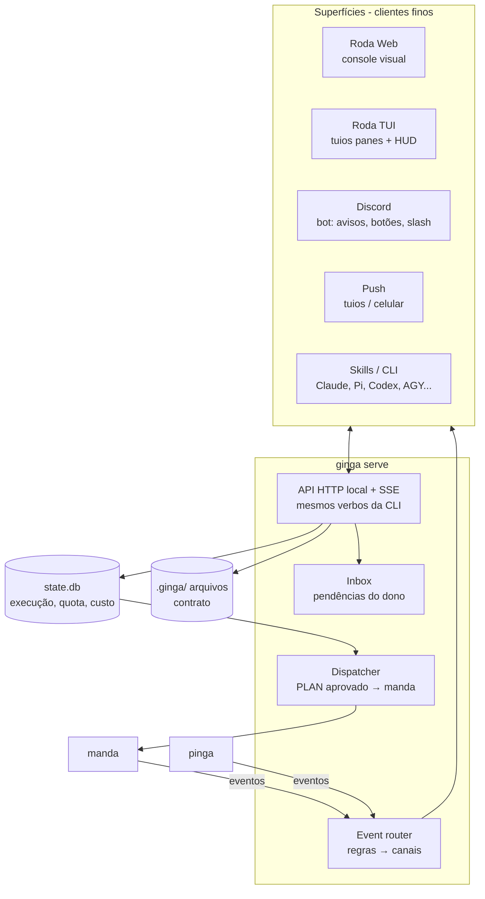

# 05 — Interface: Roda

Objetivo: dar ao dono uma forma **visual** de ver, aprovar, comandar e ser notificado, sem precisar abrir uma conversa com um agente para cada coisa. A conversa continua existindo, mas como uma superfície entre outras.

## 1. Princípios

1. **Uma API, várias superfícies.** Toda ação é um verbo do `ginga`, exposto na CLI e numa API HTTP local com SSE. Web, TUI, Discord, push e skills são clientes finos: nenhuma regra mora na superfície. Uma ação que só existe num lugar é bug.
2. **Inbox primeiro.** O que espera o dono (aprovar, responder um blocker, liberar budget) aparece antes de tudo, em qualquer superfície.
3. **Tudo é evento.** As superfícies assinam o fluxo de eventos (`$GINGA_EVENTS` → event router). Não existe polling ad hoc.
4. **Ação em um toque, mas auditável.** Aprovar pelo celular é um clique, e fica registrado quem, de onde e quando (`log.md` do PLAN + evento).
5. **Pensado para quando o dono está longe.** O trabalho é assíncrono, então Discord e web precisam funcionar bem no celular.
6. **Silêncio por padrão.** Só notifica o que pede ação ou fecha um ciclo. Retry interno não vira notificação.

## 2. Arquitetura



As **superfícies** nunca editam arquivos: chamam verbos. O **contrato** (INTENT/SPEC/PLAN/TASK/LEARNINGS) é escrito por agentes e humanos como arquivo; o **estado de execução** só pelo `ginga serve`/`tick`, no `state.db`. Ver "Donos" em [02](02-visao-atualizada.md).

### Verbos (o contrato entre as superfícies)

| Verbo | O que faz |
|---|---|
| `intent new <texto>` | Cria um INTENT (com a origem: web, discord, cli...) |
| `approve <SPEC\|PLAN>` / `reject <id> <motivo>` | Gate de aprovação |
| `answer <blocker-id> <texto>` | Responde um blocker e destrava |
| `pause` / `resume [PLAN]` | Pausa e retoma a fila inteira ou um PLAN |
| `retry <TASK> [--tier X]` / `escalate <TASK>` / `cancel <PLAN>` | Controle de execução |
| `budget raise <PLAN> <US$>` | Libera um gasto que excedeu o teto |
| `decide <item> <opção>` | Escolhe uma opção de uma decisão do Inbox (ex.: destino de worktree) |
| `handoff <PLAN>` | Gera o handoff ([06](06-handoff-e-learnings.md)) |
| `learning promote <id>` | Promove um learning a LESSON |
| `init` | Onboarding de um repo (`.ginga/` + `project.toml`) |
| `tick` / `serve` | Despacha uma vez / sobe o daemon (API, SSE, timer) |
| `status` / `board` / `inbox` / `quota` | Leitura |
| `watch <PLAN\|TASK>` | Stream ao vivo (SSE) |

## 3. Telas da Roda Web

Base: o `p-inga/web` atual (Bun + SSE na :4242). Layout responsivo, com barra lateral no desktop e abas embaixo no celular.

### 3.1 Inbox: "Esperando você"

```
┌ Roda ─────────────────────────────────────────── ● 3 pendências ┐
│ Inbox │ Quadro │ Modelos │ Ledger │ Bench          [+ Intent]  │
├─────────────────────────────────────────────────────────────────┤
│ ⚑ BLOCKER  SPEC-0007 auth-oauth                       há 12 min │
│   "Refresh token: rotação a cada uso ou janela fixa?"           │
│   [ Rotação ]  [ Janela fixa ]  [ Responder… ]                  │
├─────────────────────────────────────────────────────────────────┤
│ ✓ APROVAR  PLAN-0006 cache-ledger · 4 TASKs · ~US$0,40          │
│   linter ok · tiers: free×3 strong×1                            │
│   [ Aprovar ]  [ Ver plano ]  [ Rejeitar… ]                     │
├─────────────────────────────────────────────────────────────────┤
│ $ BUDGET  PLAN-0005 atingiu US$1,50 (teto)                      │
│   TASK-03 falhou 2× em medium, quer subir para strong           │
│   [ +US$1 ]  [ Pausar PLAN ]  [ Ver tentativas ]                │
└─────────────────────────────────────────────────────────────────┘
```

Cada card tem a resposta mais provável como botão e um "Responder…" livre. Respostas livres viram texto no artefato (seção *Respostas* da SPEC).

### 3.2 Quadro

```
 INTENT      SPEC        PLAN        EXECUTANDO       VERIFICANDO    FEITO
 ┌───────┐  ┌────────┐  ┌────────┐  ┌────────────┐   ┌──────────┐  ┌──────┐
 │0008   │  │0007 ⚑  │  │0006 ✓? │  │0005        │   │0004      │  │0002 ✓│
 │deepen │  │oauth   │  │cache   │  │■■■□□ 3/5   │   │judge:agy │  │      │
 └───────┘  └────────┘  └────────┘  │qwen3.8 ⟳   │   └──────────┘  └──────┘
                                    └────────────┘
 ⚑ blocker   ✓? aguardando aprovação   ⟳ rodando   filtros: [repo ▾] [trilha ▾]
```

### 3.3 Detalhe do PLAN

```
PLAN-0005 resiliência-runner                    approved · US$0,92 / 1,50
SPEC-0005 ↗   repo: pi-harness                  [Pausar] [Cancelar]
──────────────────────────────────────────────────────────────────────
TASKs (DAG)                      tentativas
 TASK-01 runner      ✓ receipt   1  zen/glm-5.3-flash-free   12k tok  $0
 TASK-02 retry       ✓ receipt   2  go/qwen3.8-flash → ok    41k tok  $0
 TASK-03 docs  ──┐   ✗ verify    2  go/qwen3.8-flash ✗✗               [Retry] [Escalar ▲]
 TASK-04 bench ◄─┘   · bloqueada por TASK-03
──────────────────────────────────────────────────────────────────────
log  14:02 TASK-03 tentativa 2 falhou: done_when exit 1 (ver saída ▸)
     13:40 Planner reescreveu TASK-03 (touch reduzido)
```

### 3.4 Ao vivo

Abre a partir de qualquer TASK em execução: stream do runtime (SSE), o `done_when` rodando e o resultado do `pinga verify`. É a mesma informação que um pane do tuios mostra.

### 3.5 Modelos e quota

```
Provider        janela          uso            reseta     fonte
claude-pro      5h / 7d         ▓▓▓▓░ 72%      18:00      statusline rate_limits
chatgpt-go      30 dias         ░░░░░  1%      nov/26     ~/.codex rollout rate_limits
gemini-pro      ?               ?              ?          manual (barra do agy)
opencode-go     ?               ?              ?          a descobrir
zen (pago)      mês             ▓░░░░ US$1,80 / 10        state.db
FTPR por modelo (maestro): qwen3.8-flash 71% · glm-5.3-flash-free 58% · ...
```

### 3.6 Ledger e Bench

Receipts com filtro por repo e PLAN, e tendência das métricas de bench por SPEC com `bench:`. Reaproveita o scoreboard e o grafo do `p-inga/web` atual.

## 4. Discord

- **Uma thread por PLAN** (ou por SPEC, enquanto não há PLAN). Tudo daquele trabalho fica num lugar só, e o histórico serve de conversa.
- **Blocker:** mensagem com as opções numeradas e "responda na thread". A resposta na thread vira `answer`. Botões interativos ficam para depois (o `hermes send` não tem botões; o adapter interno do Hermes tem `discord.ui`, a testar).
- **Aprovação:** card com resumo, custo estimado e os botões `Aprovar` / `Ver na Roda`.
- **Slash commands:** `/ginga intent`, `/ginga status`, `/ginga inbox`, `/ginga pause`, `/ginga approve <id>`.
- **Segurança:** só os user IDs na allowlist podem disparar verbos de escrita.
- **Base:** o Hermes é o adapter padrão (`hermes send` + gateway + plugin), e o `p-inga/src/discord.ts` fica como fallback. Ver [DECISION-0002](../../decisions/DECISION-0002-mensageria-e-fila.md), que também define a fila (`ginga tick`) e onde o ginga roda.

## 5. TUI e push

- **TUI:** um layout tuios com Inbox + Quadro (compacto) + Ao vivo. Ações rápidas via `homelab ctl` (gum/fzf) viram `ginga` verbos. A HUD do claude-plugin vira uma superfície a mais, lendo a mesma API.
- **Push:** só para *blocker* e *budget*, pelo push do tuios ou pelo celular pareado.

## 6. Regras de notificação (padrão)

| Evento | Web/TUI | Discord | Telegram / Push |
|---|---|---|---|
| Blocker / pergunta crítica | Inbox | thread + menção | sim |
| SPEC ou PLAN aguardando aprovação | Inbox | card | não |
| Budget a 80% / teto atingido | banner / Inbox | mensagem / card | não / sim |
| TASK falhou (vai tentar de novo) | Ao vivo | — | — |
| TASK esgotou tentativas → blocked | Inbox | thread + menção | sim |
| PLAN concluído (Judge ok) | Quadro | thread: resumo + verdict | não |
| Judge reprovou → novo INTENT | Inbox | thread | não |
| Digest diário | — | 1 mensagem | — |

As regras são configuráveis por projeto em `.ginga/project.toml`.

## 7. O que reaproveitar

| Peça existente | Vira |
|---|---|
| `p-inga/web` (server.ts, sse.ts, index.html) | Base da Roda Web |
| `p-inga/src/discord.ts` | Notifier do Discord |
| `bin/homelab` (ctl, tui, web, hud) | Comandos `ginga` |
| `scripts/tuios-fleet.sh`, `bin/tuios-control-center.sh` | Layout da Roda TUI |
| `pi-harness/claude-plugin` (HUD, `harness_status`/`harness_next`) | Superfície Claude Code |
| `pi-harness/intents/0055` (console unificado) | **Substituída** por este documento |

## 8. Fases

1. **Leitura:** `ginga serve` lendo o `.ginga/` + Roda Web com Inbox, Quadro e PLAN (sem ações). Já substitui o `index.md` escrito à mão.
2. **Ações:** verbos de aprovação, resposta, pausa e retry na web e na CLI.
3. **Discord:** threads, botões e slash commands.
4. **Ao vivo + quota:** SSE dos runtimes e leitura automática de quota (Codex e Claude primeiro).
5. **TUI e push.**

## 9. Protótipos

Canvas clicável: https://claude.ai/artifact/7XAsg1EnU9YMCRwtUWzL17 (privado). Fontes copiadas em [prototipos/](prototipos/).

| Artboard | O que testa |
|---|---|
| Roda Web | Inbox com ações (resolver, responder livre), Quadro kanban, detalhe do PLAN (retry, escalar, pausar, ao vivo, log), Modelos e quota, criação de INTENT |
| Discord | Uma thread por PLAN/SPEC, cards com botões, resposta registrada, slash commands, digest |
| Telegram | Celular: inline keyboard para decisões rápidas, /status, /inbox, /pause |
| Roda TUI | Três panes (Inbox, Quadro, Ao vivo) com atalhos de teclado (a, r, e, p, i, o) |
| SPEC aberta | Ler objetivo e ACs com a avaliação do Spec Judge por AC, responder o blocker no lugar, aprovação só liberada sem blockers |
| Ledger e Bench | Receipts filtráveis (repo, falhas), integridade da cadeia, FTPR; métricas de bench por SPEC contra o baseline, com regressão destacada |
| Onboarding | `ginga init` em 5 passos: projeto detectado, provider de contexto, runtimes encontrados, canais do Hermes, revisão do `project.toml` |
| Métricas | KPIs (execuções, taxa de falha, FTPR, custo pago, custo por TASK ok, escaladas), execuções ok vs falha por dia com tabela alternativa, custo por SPEC/PLAN/TASK, motivos de falha, fluxo (onde o tempo vai), TASKs mais caras |

### Métricas: de onde vem cada número

| Métrica | Fonte | Pergunta que responde |
|---|---|---|
| Execuções, falhas, motivos | eventos `attempt` (`$GINGA_EVENTS`, hoje `pi-harness/state/events.jsonl`) | Os modelos baratos estão dando conta? Por que falham? |
| FTPR, escaladas de tier | eventos + receipts do ledger (scoreboard do `pinga maestro`) | O Planner está quebrando bem? Algum tier precisa mudar? |
| Custo por TASK/PLAN/SPEC | `state.db` (custo por tentativa, agregado pelas relações do frontmatter) | Onde o dinheiro vai? Alguma SPEC está saindo cara demais? |
| Fluxo (espera do dono, fila, execução, verificação) | timestamps das transições de estado | O gargalo sou eu (Inbox parado) ou a fila (quota)? |

"Quota esgotada" e "infra" não contam contra o modelo no FTPR, mas aparecem na taxa de falha.
