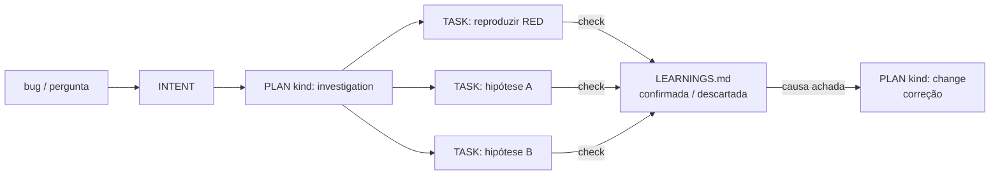
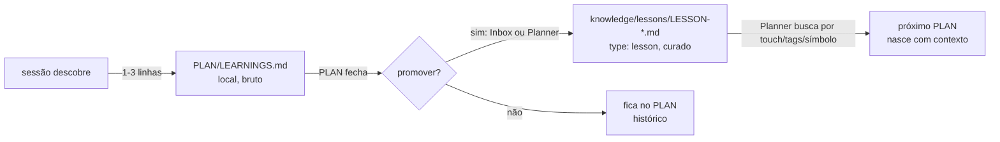

# 06 — Handoff e learnings

> Origem: [INTENT-0005](../../../intents/INTENT-0005-handoff-e-learnings.md).

## 1. A ideia

**O handoff não é gerado no corte. Ele é efeito colateral do trabalho.**

Como o estado vive em arquivos (INTENT, SPEC, PLAN, TASK, `log.md`, `LEARNINGS.md`, receipts e git) e cada check grava na hora, cortar a sessão não perde nada. O handoff só **renderiza** o que já está escrito, sem LLM.

A compactação de cada ferramenta (Claude Code, Codex, Pi...) é uma caixa-preta: resume a conversa com um LLM, perde detalhes de forma imprevisível e não dá para medir. Nós não competimos com ela. Nós a tornamos desnecessária.

## 2. Duas trilhas de escrita dentro do PLAN

| | `log.md` | `LEARNINGS.md` |
|---|---|---|
| Conteúdo | **O que aconteceu** | **O que sabemos agora** |
| Quem escreve | O sistema, automático: tentativas, receipts, transições, handoffs | A sessão, 1–3 linhas por descoberta |
| Quando | A cada evento | A cada check que ensina algo, principalmente os que falham |
| Exemplo | `14:02 TASK-03 tentativa 2 falhou: done_when exit 1` | "O docs_contract compara o texto exato: ajustar o `usage.md`, não o teste" |

Regra para os agentes: **gravou um check, escreveu o learning.** Sem isso, um check que falha conta como trabalho perdido no handoff.

### Formato de um learning

```markdown
## L-03 · descartada · 2026-10-27 14:20
- hipótese: o timeout vem do spawn do opencode
- evidência: TASK-02 reproduziu com spawn mockado → ainda falha
- conclusão: não é o spawn; está no parser de JSONL (próxima TASK)
- escopo: src/pipeline/task_runner.ts
```

O status é um destes: `confirmada`, `descartada`, `fato` (algo do ambiente ou do código) ou `armadilha` (não faça X).

## 3. Debug e investigação são PLANs

`PLAN.md` com `kind: investigation`:

- **Cada TASK é uma hipótese ou um experimento.** Exemplos: "reproduzir com teste RED", "isolar se é o parser", "bisect entre v0.3 e v0.4".
- O `done_when` é o check da hipótese. O resultado vira learning `confirmada` ou `descartada`.
- **Becos sem saída ficam registrados**, que é justamente a parte difícil que a compactação perde.
- Quando a causa é encontrada, o PLAN pode gerar um PLAN de correção normal (`kind: change`, o padrão) que herda os learnings por referência.



## 4. Handoff

### Comando

`ginga handoff <PLAN>` monta, de forma determinística:

1. o PLAN (objetivo e abordagem) e a SPEC, se houver;
2. as TASKs com estado e a última tentativa;
3. os learnings, com `descartada` e `armadilha` primeiro;
4. a próxima TASK aberta;
5. `git status` e diff resumido;
6. os blockers abertos.

O resultado vai para `.ginga/handoffs/HANDOFF-<data>-<PLAN>.md` (`type: handoff`) e substitui os `HANDOFF-NNNN.md` escritos à mão. A sessão nova começa lendo esse arquivo.

### Gatilhos

| Gatilho | Regra | Prioridade |
|---|---|---|
| Fronteira natural | TASK fechou ou o PLAN mudou de fase | preferida: perde menos nuance |
| Contexto cheio | passou de ~60–70% da janela (antes do auto-compact da ferramenta) | forçada |
| Cache expirando | sessão ociosa perto do TTL e `custo_retomar < custo_próximo_turno` | forçada se compensar |

A conta do cache:

```
custo_próximo_turno = tokens_contexto × (preço_leitura_cache se quente | preço_escrita_cache se frio)
custo_retomar       = tokens_handoff  × preço_escrita_cache + tokens_sistema
```

O TTL e os multiplicadores de cache entram nos `models/PROVIDER-*.md` (campos `cache_ttl`, `cache_read_mult`, `cache_write_mult`).

Os thresholds começam conservadores e quem define os valores finais é o A/B (§6).

### Integração por runtime

| Runtime | Medir o contexto | Disparar / injetar |
|---|---|---|
| Claude Code | statusline (uso de contexto, `rate_limits`) | hooks `PreCompact` e `SessionStart` (a confirmar se dá para substituir o auto-compact por completo) |
| Codex | rollout JSONL (tokens por turno) | wrapper do ginga |
| Pi | extensão | `task_checkpoint` / `task_resume` do pi-harness como base |
| Executores do manda | — | já seguem "um processo = uma tentativa"; o handoff entre tentativas é o próprio PLAN |

## 5. Ciclo de vida dos learnings



- **Local primeiro:** barato, sem cerimônia.
- **Promoção quando o PLAN fecha:** o Planner propõe quais learnings valem fora do PLAN, e o dono aprova no Inbox (com um botão por learning). A promoção vira uma `LESSON-*.md` com escopo (repo, arquivos, símbolos, tags) e evidência (receipt ou commit).
- **Reuso:** ao montar um PLAN, o Planner busca as lessons pelos caminhos do `touch`; com o gira, a busca pode ser por símbolo. As lessons encontradas entram no PLAN como referência.
- Isto substitui o DREAMS e o `LESSONS.md` dos repos.

## 6. Validação com métricas (A/B)

Experimento na ontologia de bench (`experiment → arm → run`): braço **compactação nativa** contra braço **handoff do ginga**, com `methodology_version` próprio.

| Métrica | Pergunta |
|---|---|
| **Erros repetidos** (mesma falha depois de existir um learning sobre ela) | O sistema aprende? É o indicador principal |
| Custo e tokens por TASK verificada, depois do corte | Economizou? |
| FTPR depois do corte | A sessão retomada erra mais? |
| Tokens de redescoberta nos primeiros turnos | O handoff passou o contexto certo? |
| Learnings reutilizados por PLANs posteriores | As lessons são úteis? |
| Handoffs por gatilho e US$ economizado (estimado) | Quando compensa? |

Tudo isso entra no painel **Sessões e aprendizado** do dashboard de Métricas.

## 7. Base existente

| Peça | Vira |
|---|---|
| `p-inga/src/compact.ts` | Descartado (compactação por truncamento) |
| `p-inga/src/learn.ts`, `lessons.ts` | Ingestão e promoção para `knowledge/lessons/` |
| `pi-harness/.pi/extensions/dreams.ts`, `LESSONS.md` | Substituídos pelo ciclo acima |
| `pi-harness/src/async/task_checkpoint.ts`, `task_resume.ts` | Base do checkpoint por TASK |
| `pi-harness/HANDOFF-0043.md` (manual) | Exemplo do que o `ginga handoff` gera |
