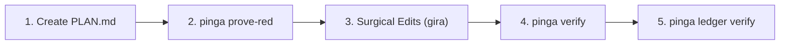

# Workspace Governance — P-Ingá & Gira-G

> **Start every session at [`.ginga/index.md`](.ginga/index.md)**: work board (INTENT/SPEC/PLAN/TASK), what is ready to pick up, what is waiting on the owner, and the model routing in `.ginga/models/ROUTING.md`.

## Transition (G-Ingá revamp, 2026-10-27)

- **Workspace work** (this root, `.ginga/`): follows the new convention, INTENT → SPEC → PLAN → TASK (see `.ginga/knowledge/design/ginga-revamp/04-artefatos.md`). The root is not a git repo, so its PLANs run without the pinga ledger.
- **Sibling repos** (`p-inga/`, `pi-harness/`, `gira-g/`): keep the current pinga flow (`tasks/T<N>/PLAN.md` → `prove-red` → `verify`, receipt status `pass`) until the migration PLAN of SPEC-0001 lands. Legacy `tasks/T<N>/` stay valid after it.
- **Gira is optional** (context port with `rg` + `git` fallback). Use it where it is available; its absence never blocks work.

This workspace (`duh-homelab`) is strictly governed by **P-Ingá Formal Verification** and **Gira-G Semantic Middleware**.
All autonomous agents (Claude Code, OpenAI Codex, Copilot, Pi, OpenCode, Hermes, Antigravity) **MUST** comply with the 3 Laws and Invariants below.

---

## 3 Core Laws of Agent Execution

1. **Lei 1: Token Economy & Prefix Stability**
   - Keep plans concise: `tasks/T<N>/PLAN.md` must **never exceed 25 lines**.
   - Do not dump large files into context; use `gira outline` and `gira read` for targeted AST inspection.
   - Maintain conversational prefix stability to maximize KV cache reuse.

2. **Lei 2: Mandatory Formal Verification (Zero Blind Trust)**
   - **NO DIRECT CODE CHANGES WITHOUT A VERIFIED CONTRACT.**
   - All tasks must define a verifiable contract in `tasks/T<N>/PLAN.md` containing `mode`, `goal`, `done_when`, and `touch`.
   - Before implementation, prove baseline failure with `pinga prove-red tasks/T<N>/PLAN.md`.
   - After surgical implementation, prove completion with `pinga verify tasks/T<N>/PLAN.md`.
   - Changes are only considered complete once sealed into `ledger.db` with status `pass`.

3. **Lei 3: Distinct Family Judging (Invariant I13)**
   - Code must never be approved or judged by a model of the same family as the author (e.g. Gemini audits Qwen/DeepSeek; Claude audits Gemini).
   - Use `/red-audit` or `pinga judge` for cross-family evaluations.

---

## Mandatory Task Workflow

Whenever assigned a feature, bugfix, or refactor:



1. **Create Contract (`tasks/T<N>/PLAN.md`):**
   ```markdown
   ---
   mode: padrao
   goal: "Clear objective statement"
   done_when: "bun test tests/target.test.ts"
   touch:
     - src/target.ts
     - tests/target.test.ts
   ---

   ## Context
   - Brief 5-line summary of surgical approach.
   ```
2. **Prove RED:**
   ```bash
   pinga prove-red tasks/T<N>/PLAN.md
   ```
3. **Execute Surgical Changes:**
   - Locate symbols: `gira outline <file>` or `gira read <file> <symbol>`
   - Mutate AST: `gira write <file> <symbol> --body '...'` or precise edits.
   - Never perform whole-file overwrites (> 100 lines).
4. **Formally Verify & Seal Receipt:**
   ```bash
   pinga verify tasks/T<N>/PLAN.md
   ```
5. **Verify Immutable Ledger:**
   ```bash
   pinga ledger verify
   ```

---

## Available Skills & Tools

- `/pinga` — Primary formal verification, contract execution, scoreboard, and doctor.
- `/red-audit` — Adversarial audit, contract gap diagnosis, and surgical AST repair loop.
- `pinga doctor` — Validate multi-harness integrations across Claude, Pi, OpenCode, Hermes, and TUIOS.
- `pinga maestro scoreboard` — Review worker token efficiency and first-time pass rates (FTPR).
- `pinga maestro recommend <PLAN.md>` — Recommend execution plan tier (Plano A vs Plano B).
- `pinga docs eval <target>` — LLM-as-a-judge documentation evaluator.
